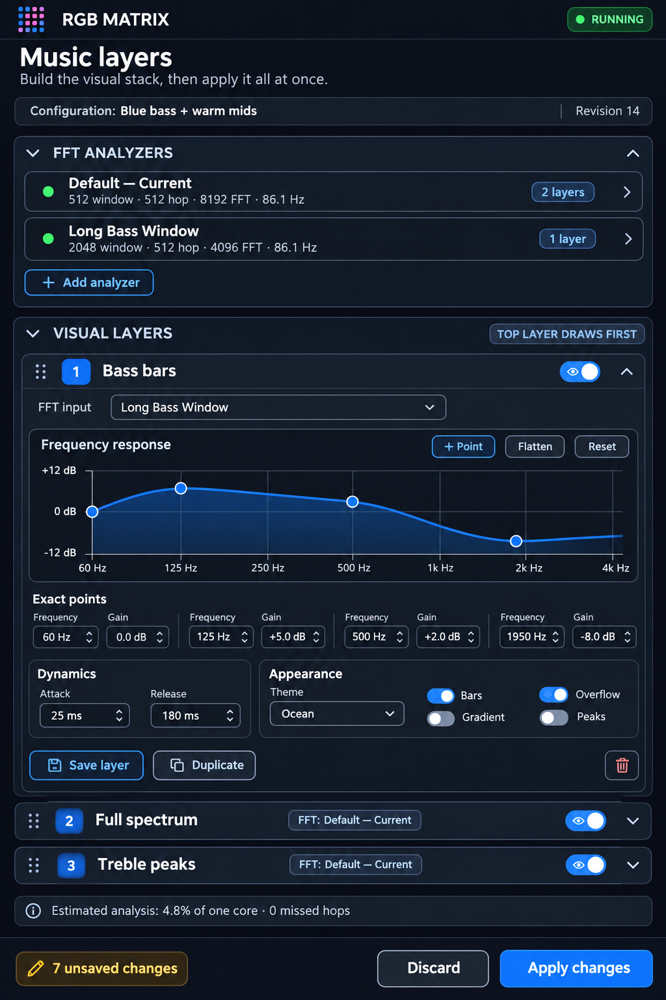

# FFT / Music Refactor Plan

Status: planning only — no implementation in this leg

Target: Raspberry Pi 4 at `10.8.184.98`, one 64x64 HUB75 panel, Adafruit
HAT/Bonnet mapping, current USB microphone, future Bluetooth phone input

This folder is the authoritative plan for turning the current FFT program into a
multi-analyzer, multi-layer music visualization system with a usable phone editor.
It supersedes the older assumption that every visual layer must share exactly one
FFT. Audio capture is shared once, while one transform is scheduled for each
distinct active FFT analyzer configuration.

## Decisions

1. Keep Python as the product/orchestration language. NumPy performs the FFT in
   compiled code and `rpi-rgb-led-matrix` performs panel refresh in native C++.
2. Replace the implicit audio/layer arrays with two explicit object types:
   **FFT analyzers** and **visual layers**.
3. A visual layer references an FFT analyzer by stable `analysis_source_id`.
   Multiple visual layers may use the same analyzer at no additional FFT cost.
4. Capture audio once into a timestamped ring buffer. Run an analyzer once per new
   hop and cache its immutable output. Never run an FFT merely because a display
   frame is being drawn.
5. Let users edit a local draft and press **Apply** once. Applying validates and
   swaps the complete configuration atomically; individual field edits do not
   mutate the running display.
6. Use logarithmic frequency on the X axis and gain in dB on the Y axis for the
   visual-layer response editor. Support two to eight synchronized graphical and
   numeric control points.
7. Use opaque topmost-wins composition for the first release. Render visual layers
   from top to bottom and fill only pixels that are not already covered. Alpha and
   opacity are deferred.
8. Compose a complete RGB frame in memory and publish it with the binding's bulk
   `SetImage()` path followed by `SwapOnVSync()`. Keep per-pixel `SetPixel()` as a
   compatibility path only.
9. Store layer templates, analyzer favorites, complete configurations, and the boot
   default through the controller/user-owned service. The privilege-dropped matrix
   child must not own durable state.
10. Make Bluetooth a separate delivery plan on top of the same `AudioSource`
    contract. The default Bluetooth mode analyzes the incoming phone stream without
    playing it; optional playback through a Pi audio output can be added later.

## Terminology

- **Audio source**: Produces timestamped PCM, for example the Dayton iMM-6C USB mic
  or a phone connected to the Pi as an A2DP source.
- **FFT analyzer**: Owns a window length, hop length, FFT length, window function,
  and spectral output format. It publishes immutable spectrum frames.
- **Analysis frame**: A timestamped result for one analyzer and one PCM sequence.
- **Visual layer**: Maps an analysis frame into pixels using a frequency range,
  response curve, temporal processing, and renderer settings.
- **Layer template**: A named reusable visual-layer definition.
- **Analyzer favorite**: A named reusable FFT analyzer definition.
- **Configuration**: The complete set of analyzers, ordered visual layers, and
  presentation settings.
- **Applied state**: The configuration currently used by the music runtime.
- **Draft state**: Browser-local edits that have not been applied.

## Plan documents

1. [Current system audit](00-current-system-audit.md)
2. [Product, state, and control model](01-product-state-and-control-model.md)
3. [Runtime and multi-analyzer architecture](02-runtime-and-analysis-architecture.md)
4. [Web/mobile editor and persistence](03-web-mobile-editor-and-persistence.md)
5. [Rendering, performance, and telemetry](04-rendering-performance-and-telemetry.md)
6. [Audio sources and Bluetooth](05-audio-sources-and-bluetooth.md)
7. [Implementation roadmap and acceptance gates](06-implementation-roadmap.md)

## Draft interface mockup



The mockup shows the intended information hierarchy and draft/Apply workflow. It is
a product-design reference rather than a pixel-perfect implementation requirement.

## Target system at a glance

```text
user-owned audio service
  USB mic / Bluetooth PCM
             |
             v
  timestamped PCM ring (one capture)
             |
             v
  FFT analyzer registry
    FFT A -> cached SpectrumFrame A <- Visual layers 1, 2, 5
    FFT B -> cached SpectrumFrame B <- Visual layers 3, 4
    FFT C -> cached SpectrumFrame C <- Visual layer 6
             |
             v
  ordered visual-layer processors
             |
             v
  opaque coverage compositor (top -> bottom, unclaimed pixels only)
             |
             v
  preallocated RGB frame -> bulk SetImage -> SwapOnVSync
             |
             v
  native HUB75 refresh thread
```

## Success definition

The refactor is complete when a phone can create several FFT analyzers, connect any
number of ordered visual layers to them, edit frequency/gain curves precisely, apply
the entire draft as one command, save individual pieces or the complete
configuration, and reload them without audio dropouts, partial states, redundant
FFTs, or visible frame regressions.

## Requirement traceability

| Required concern | Planned enforcement |
| --- | --- |
| One calculation per new analyzer hop | Sample-addressed scheduler and per-analyzer `next_due_end` in [runtime architecture](02-runtime-and-analysis-architecture.md#scheduler) |
| No reanalysis of an unchanged block | Unique `(source_generation, analyzer_compute_id, end_sample)` frame identity and duplicate rejection |
| No per-visual-layer FFT | Visual layers consume cached immutable analysis frames; consumer count is excluded from the analyzer computation key |
| CPU-budget validation before Apply | Distinct-computation estimate, hard limits, staging, and rejection in [CPU-budget validation](02-runtime-and-analysis-architecture.md#cpu-budget-validation) |
| Processing/missed-hop/audio/frame telemetry | Fixed-size metrics defined in [rendering and telemetry](04-rendering-performance-and-telemetry.md#telemetry-model) |
| Avoid drawing hidden/covered lower layers | Opaque top-first coverage mask, hidden-layer cull, remaining-mask render, and full-frame early exit |
| Current duplicate/repeated FFT defect | Recorded in [current system audit](00-current-system-audit.md#current-data-flow-violations) and removed in roadmap Phase 1 |
| Bluetooth initially silent, optional Pi output | Analysis-only default and a separate optional playback follow-up in [audio sources](05-audio-sources-and-bluetooth.md) |
